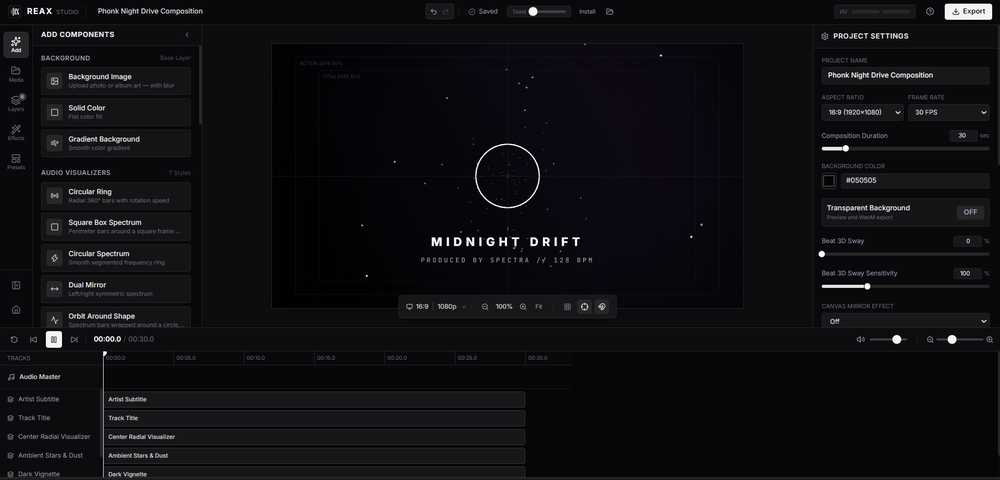
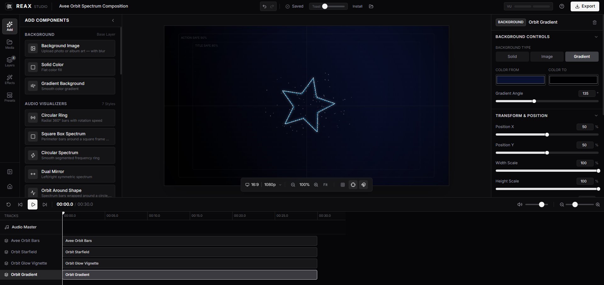
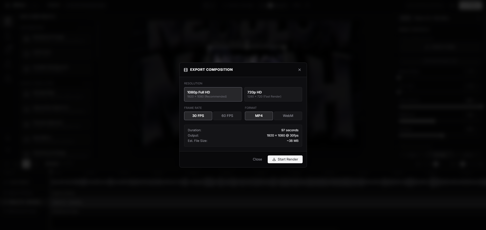

# REAX

REAX is a browser-based music visualizer and video editor for creating audio-reactive visuals and exporting music videos. It runs in the browser and focuses on a local-first editing workflow: import audio, build scenes with layers, tune how visuals react to sound, and export from the studio.

**Live application:** https://reax.ndkdev.tech

## Screenshots

Add or replace screenshots in the `screenshots/` directory.

| Editor | Visualizer | Export |
|---|---|---|
|  |  |  |

## What REAX includes

### Audio and analysis
- Audio upload and real-time frequency analysis
- Band-based reaction mapping: **bass, mids, highs, all**
- Beat/kick-aware visual response controls (where supported by effects)
- Playback controls including scrub/playback workflow in the editor
- Audio trim and playback-rate controls (implemented in the app)

### Visual layers
- **Visualizer** styles (including circular, spectrum, waveform, dual mirror, square bars, orbit and related modes)
- **Radial Wave** layers with configurable wave behavior and styling
- **Particle** layers/presets for ambient and reactive motion
- **Image** layers with audio-reactive overlay options (including bottom bars mode in the app)
- **Text** and **shape** layers for titles and graphic elements
- **Background** and composition layers

### Composition and timeline
- Multi-layer scene composition
- Layer visibility, ordering, selection, and property editing
- Timeline with playback/scrubbing and clip timing controls
- Transform and layout controls for positioning/scaling content
- Templates/presets and saved local projects (browser storage)

### Effects and output
- Beat-reactive scene controls (blur/shake/punch and mirror-related options, as available in editor settings)
- Post-style/composition adjustments supported by the editor
- Video export workflow from the REAX studio

> For a detailed breakdown, see [`docs/FEATURES.md`](docs/FEATURES.md).

## Documentation

- [Documentation index](docs/README.md)
- [Feature reference](docs/FEATURES.md)
- [Editor workflow](docs/WORKFLOW.md)

## Feedback

If you find a bug, want to request a feature, or have a suggestion, please open a [GitHub Issue](https://github.com/ndk123-web/reax-public/issues).

## Notes

- This repository is a public showcase for REAX (README, screenshots, docs). It does not contain the application source code.
- Feature availability can evolve as the product is updated; the live app at https://reax.ndkdev.tech is the source of truth.
